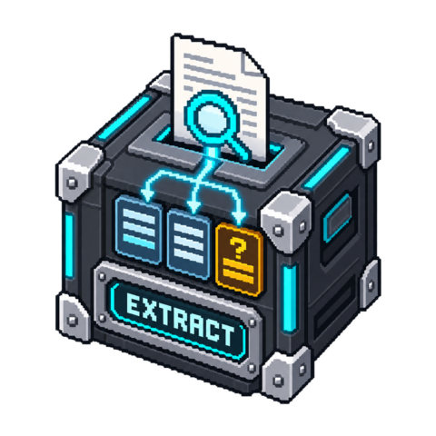

# Structured Extract

Extract fields from explicit source locations and retain evidence for every selected
value. This local, deterministic block uses literal text selectors or JSON Pointers,
then validates the result against a configured schema. It does not call an LLM.

<!-- block-metadata:start -->
[](model.json)
[](compatibility.json)
[](LICENSE)

Verified BloxSmith versions: **1.0.9** (bundled-block tests; see [test evidence](compatibility.json)).
<!-- block-metadata:end -->

[](media/cover.png)

## Ports

| Direction | Port | Payload |
| --- | --- | --- |
| Input | `content` | Text, referenced sections or JSON, as selected by configuration |
| Input | `sources` | Optional provenance object, supplied before content; no implicit wait |
| Output | `data` | Extracted object, only when the complete target schema passes |
| Output | `evidence` | Per-field source, exact span/JSON Pointer, quoted value and input digest |
| Output | `issues` | Missing, ambiguous, conversion or schema diagnostics; partial/truncated flags |

A missing or ambiguous optional field is omitted. If the target schema requires it,
no data output is emitted. Evidence and issues still report the successful extraction
attempt. Invalid configuration, malformed input, cancellation or a size limit produces
a failed result with no outputs. Previous downstream values are not erased.

## Example

With the default settings, send:

```text
Reference: INV-0042
Customer: Sample Company
```

The data output is `{"reference":"INV-0042"}`. Evidence points to the exact
characters of `INV-0042`. A second matching Reference line is treated as ambiguous,
even when both values happen to be identical.

## Configuration

- `input_format`: `text`, `sections` or `json`.
- `fields`: map output field names to literal or pointer selectors.
- `schema`: explicit object schema. Every declared property/required field must have a selector.
- Advanced: input byte limit, maximum characters in one field, maximum issue count.

Selector examples:

```json
{
  "reference": {"mode":"line_prefix","prefix":"Reference:","type":"string"},
  "amount": {"mode":"between","start":"Total [","end":"]","type":"number"}
}
```

Text matching is case-sensitive, literal, and local to one section. `line_prefix`
must start the line; the value is the remainder. `between` uses the next closing
delimiter. Surrounding whitespace is trimmed, and evidence offsets refer to the trimmed
span. Offsets are Unicode code-point positions, not UTF-8 bytes or browser UTF-16 indices.
No regular expressions, fuzzy matching, semantic inference or hidden defaults are used.

In JSON mode all selectors use `pointer`, for example:

```json
{"reference":{"mode":"pointer","path":"/invoice/reference","type":"string"}}
```

Pointers use standard `~0` / `~1` escaping. Empty selects the root. Null is
different from a missing value. JSON evidence is canonical JSON, not a claim to preserve
the original lexical formatting.

Sections accept an array of objects containing `text`, optional `source` and
`id` / `page` / `paragraph` / `section` references. An object containing only
`sections` is also accepted. Document Reader's sections output connects directly.
OCR's richer page objects need an explicit upstream mapping to this section format.
Supplied source identities are retained, not authenticated or independently fetched.

Supported field types: string, number, integer, boolean, object, array, null.
Non-string text values must be strict finite JSON literals: no guessed decimal comma,
currency stripping, date conversion or loss of leading zeros. Keep reference numbers
as strings. Schema conformity does not prove the content is factually correct.

## Schema subset

Supports object/boolean subschemas and `type`, `properties`, `required`,
boolean `additionalProperties`, `items`, length/item/numeric bounds,
`enum`, `const`, `title` and `description`. The root must be an object schema.
Unsupported keywords are refused, including remote references, regex, format validators
and combinators. This is not an implementation of the full JSON Schema standard.

## Limits and use with agents

At most 64 fields, 1,000 sections, 4 MiB input, 100,000 characters per field,
1,000 published issues and 4 MiB combined output. Input JSON has depth and node bounds;
schema nesting is limited to 16. No file reads, model downloads, network requests or
secrets are needed. Evidence and outputs contain source text; connect only intended consumers.

For free-form semantic interpretation, reuse an upstream Codex/Claude/API block and
a separately reviewed instruction/schema. This block does not pretend literal selection
can understand every document. It is the extraction/checking component for explicit
templates and structured data, not a second agent or an Instructor integration.

## Tests and license

Package-owned functional, real-runtime and managed/linked browser suites use local
fixtures only. Responsive forms support explicit Apply, Cancel and draft retention.
Apache-2.0.
